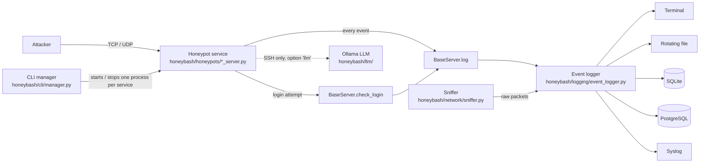

# HoneyBash — Project Documentation

HoneyBash is a multi-protocol honeypot framework written in Python. It runs fake network services
(SSH, HTTP, FTP, MySQL, ...) that look real to an attacker, and records everything the attacker
sends: connections, usernames and passwords, commands, queries and raw payloads. The recorded
events can be printed to the terminal, written to rotating log files, stored in SQLite or
PostgreSQL, or sent to syslog.

The SSH honeypot can optionally answer attacker commands with a **local LLM (Ollama)**, so the fake
shell responds convincingly to commands it has never seen. Nothing leaves the machine.

> Use only on networks you own or are authorised to monitor. See the disclaimer in the README.

---

## 1. How it works (the big picture)



1. The **CLI manager** parses the command line and an optional JSON config file, then starts each
   requested honeypot as its own OS process.
2. Each **honeypot service** listens on a port, speaks just enough of its protocol to look real,
   and calls `self.log({...})` for every interesting event.
3. Login attempts go through `check_login()`, which logs the attempt and says whether it matched
   the decoy credentials (default `test` / `test`). Everything else is rejected.
4. The **event logger** turns each event into a JSON record, applies optional filters from the
   config, and sends it to the configured destinations.
5. An optional **sniffer** captures raw packets (TCP scans, ICMP, payloads containing
   `pass`/`user`/`login`) and logs them the same way.

---

## 2. Project structure

```text
HoneyBash/
├── setup.py                  # package metadata, dependencies, `honeybash` console script
├── requirements.txt          # pip dependencies
├── README.md                 # quick start
├── docs/DOCUMENTATION.md     # this file
└── honeybash/
    ├── __init__.py           # re-exports public classes, __version__ = "1.0.0"
    ├── __main__.py           # `python -m honeybash` -> cli.manager.main_logic
    ├── cli/
    │   ├── manager.py        # argument parsing, start/stop services, chameleon mode, stats loop
    │   └── banner.py         # ASCII banner
    ├── config/
    │   └── config_manager.py # reads JSON config; applies per-honeypot settings (set_local_vars)
    ├── core/
    │   ├── base_honeypot.py       # BaseServer: process control, check_login, log
    │   └── base_http_honeypot.py  # BaseHttpServer: shared HTTP/HTTPS request handling
    ├── honeypots/            # one file per protocol (section 4)
    ├── llm/
    │   ├── ollama_client.py  # minimal Ollama HTTP client (stdlib only)
    │   └── shell_emulator.py # per-session LLM-backed fake shell
    ├── logging/
    │   └── event_logger.py   # JSON serialisation, filters, terminal/file/DB/syslog handlers
    ├── storage/
    │   └── storage_backends.py  # SqliteClass, PostgresClass
    ├── network/
    │   └── sniffer.py        # scapy packet sniffer (QSniffer)
    ├── utils/
    │   └── network_utils.py  # per-service CLI args, ports, certificates, helpers
    └── data/                 # HTML pages used by the HTTP/HTTPS/proxy honeypots
        ├── home.html  login.html  dummy_page.html
```

---

## 3. Core components

### 3.1 `BaseServer` — [honeybash/core/base_honeypot.py](../honeybash/core/base_honeypot.py)
The parent class of every honeypot. It provides:

| Member | Purpose |
|---|---|
| `NAME`, `DEFAULT_PORT` | Service name used in logs and its default port (set by each subclass). |
| `__init__` | Resolves IP (default `0.0.0.0`), port, username/password (default `test`/`test`) and `options` from kwargs, the config file, or `HONEYBASH_OPTIONS`. Creates the event logger. |
| `server_main()` | Abstract. Each subclass implements the actual listener here. |
| `run_server(process, auto)` | Runs `server_main` directly, or in a separate `multiprocessing.Process`. With `auto=True` it picks a random free port. |
| `close_port()` | Frees the port if something is already listening. |
| `check_login(user, pw, ip, port)` | Logs a `login` event with `status` = `success`/`failed`; returns whether it matched the decoy credentials. |
| `log(dict)` | Adds `server`, `dest_ip`, `dest_port` and sends the event to the logger. |
| `kill_server()` / `server_is_alive()` | Stop / check the service process. |

### 3.2 `BaseHttpServer` — [honeybash/core/base_http_honeypot.py](../honeybash/core/base_http_honeypot.py)
Shared by HTTP and HTTPS. Picks a random fake `Server:` header (Apache, nginx, IIS, ...), logs each
request, serves `login.html` for `/` and `/login.html` (when credentials are set) or `home.html`
otherwise, and passes submitted `username`/`password` form fields to `check_login()`.

### 3.3 CLI manager — [honeybash/cli/manager.py](../honeybash/cli/manager.py)
`HoneyBashManager` ties everything together:
* `--setup <services>` starts one or more services (`all`, `ssh`, `ssh,http`, or `ssh:2222`).
* `--list` prints the available services, `--kill` stops running ones.
* **Chameleon mode** (`--chameleon --config file.json`) starts every honeypot listed in the config,
  requires a database log target, optionally starts the sniffer, and logs network and per-process
  CPU/memory stats every 20 seconds.
* `all_servers` is the registry mapping service names to classes.

### 3.4 Configuration — [honeybash/config/config_manager.py](../honeybash/config/config_manager.py)
`set_local_vars` reads the `honeypots` section of the JSON config and copies each key of the
matching entry onto the server object (for example `port`, `username`, `password`, `llm_model`,
`folders`, `template`). Setting `port` in the config disables the random-port `auto` mode. The
entry name is derived from the class name: `QSSHServer` → `ssh`, `QHTTPProxyServer` → `httpproxy`.

### 3.5 Logging — [honeybash/logging/event_logger.py](../honeybash/logging/event_logger.py)
`setup_logger` builds a logger whose handlers depend on the config's `logs` value, which may combine
`terminal`, `file`, `db_sqlite`, `db_postgres` and `syslog`. Events are serialised to JSON with a
`timestamp`. The optional `custom_filter` section can drop, rename or require fields.

### 3.6 Storage — [honeybash/storage/storage_backends.py](../honeybash/storage/storage_backends.py)
* `SqliteClass` — one table, `servers_table` (`id, date, server, action, status, src_ip, src_port,
  dest_ip, dest_port, username, password, data, error`).
* `PostgresClass` — JSON tables `servers_table`, `sniffer_table`, `errors_table`, `system_table`.
  Requires the optional `psycopg` driver; without it, Postgres logging is skipped with an error.

### 3.7 Utilities — [honeybash/utils/network_utils.py](../honeybash/utils/network_utils.py)
Per-service command-line parser (`server_arguments`), free-port lookup, port/process cleanup,
ephemeral self-signed TLS certificate (`create_certificate`), request header/IP extraction, and the
Windows/Linux privilege check.

---

## 4. Services and where each feature lives

Every service is one file in `honeybash/honeypots/`. Defaults are listed; ports below 1024 need
administrator/root rights.

| Service | File / class | Port | What it does and captures |
|---|---|---|---|
| **SSH** | [ssh_server.py](../honeybash/honeypots/ssh_server.py) `QSSHServer` | 22/TCP | Paramiko SSH server with a random fake banner (OpenSSH 6.4/7.3/7.5, Serv-U). Password logins are checked against the decoy; **public-key logins always succeed** and the key fingerprint is logged. Option `capture_commands` logs `exec` commands. Option `interactive` gives a fake shell (static answers for `ls`, `pwd`, `whoami`, `uname ...`); adding `llm` answers other commands with the LLM (section 5). Session lasts up to 300 s; 10 s idle per line. |
| **Telnet** | [telnet_server.py](../honeybash/honeypots/telnet_server.py) `QTelnetServer` | 23/TCP | Shows `PC login:` / `Password:`, logs the username and password via `check_login`, then closes the connection. |
| **FTP** | [ftp_server.py](../honeybash/honeypots/ftp_server.py) `QFTPServer` | 21/TCP | Twisted FTP with a random banner (ProFTPD, FileZilla, Gene6). Logs connections and logins; option `capture_commands` logs every FTP command and its arguments. Serves a temporary empty folder. |
| **HTTP** | [http_server.py](../honeybash/honeypots/http_server.py) `QHTTPServer` | 80/TCP | Decoy home and login pages from `honeybash/data/`; logs requests, optional headers (`capture_commands`) and form logins. Option `fix_get_client_ip` trusts `X-Forwarded-For` / `X-Real-IP`. |
| **HTTPS** | [https_server.py](../honeybash/honeypots/https_server.py) `QHTTPSServer` | 443/TCP | Same as HTTP behind TLS, with a fresh self-signed certificate generated at start. |
| **HTTP proxy** | [http_proxy_server.py](../honeybash/honeypots/http_proxy_server.py) `QHTTPProxyServer` | 8080/TCP | Logs each proxy request and the requested `Host`, resolves it, and returns a dummy page (custom page via the `template` config key). |
| **MySQL** | [mysql_server.py](../honeybash/honeypots/mysql_server.py) `QMysqlServer` | 3306/TCP | Sends a MySQL 5.7 handshake, parses the client's login packet, logs the username and the password (or its hash), then answers *Access denied* or *Too many connections*. Optional wordlist via the `file_name` config key to crack hashes. |
| **PostgreSQL** | [postgres_server.py](../honeybash/honeypots/postgres_server.py) `QPostgresServer` | 5432/TCP | Declines SSL, reads the startup message, requests a cleartext password and logs user and password. |
| **Redis** | [redis_server.py](../honeybash/honeypots/redis_server.py) `QRedisServer` | 6379/TCP | Parses `AUTH` commands (password only, or user and password), logs them and replies with errors. Other commands get `unknown command`. |
| **SMTP** | [smtp_server.py](../honeybash/honeypots/smtp_server.py) `QSMTPServer` | 25/TCP | Twisted ESMTP with a spoofed AWS-style hostname. Logs every non-`HELO`/`EHLO` command and `AUTH PLAIN` credentials. |
| **SMB** | [smb_server.py](../honeybash/honeypots/smb_server.py) `QSMBServer` | 445/TCP | Built on `impacket`. Exposes a read-only share (`C$` on a temp folder, or folders from the `folders` setting as `name:path,name:path`). Logs connections and NTLM challenge/response data from logins. |
| **RDP** | [rdp_server.py](../honeybash/honeypots/rdp_server.py) `QRDPServer` | 3389/TCP | Hand-built RDP handshake over TLS 1.2. Logs the connection, the `mstshash` cookie, and credentials sent in the client's info packet. |
| **DNS** | [dns_server.py](../honeybash/honeypots/dns_server.py) `QDNSServer` | 53/UDP+TCP | Twisted DNS server that forwards to `8.8.8.8` and logs every query and raw request. |
| **DHCP** | [dhcp_server.py](../honeybash/honeypots/dhcp_server.py) `QDHCPServer` | 67/UDP | Parses DHCP requests (options and client MAC) and logs them. Lease values (`dhcp_ip`, `dhcp_ip_lease`, `subnet_mask`, `router`, `dns_server`) are configurable. |
| **Sniffer** | [sniffer.py](../honeybash/network/sniffer.py) `QSniffer` | — | scapy-based packet capture on an interface. Logs TCP SYN scans (and answers with SYN-ACK), ICMP, TCP/UDP payloads, and payloads containing `pass`, `user` or `login`. Needs root/administrator and an interface name. |

Each file also has a `test_server()` method that connects to its own service, and an
`if __name__ == "__main__":` block so it can be run on its own.

---

## 5. The LLM shell (SSH only)

Files: [honeybash/llm/ollama_client.py](../honeybash/llm/ollama_client.py),
[honeybash/llm/shell_emulator.py](../honeybash/llm/shell_emulator.py), wired in
[ssh_server.py](../honeybash/honeypots/ssh_server.py) (`_handle_interactive_session`, `_respond`).

**Flow for each command typed in the fake SSH shell**

1. The command is logged as an `interactive` event.
2. If it is in the static table (`ls`, `pwd`, `whoami`, `uname ...`), that answer is returned and
   also recorded in the session history.
3. Otherwise, if `llm` is enabled, `LLMShellEmulator.respond()` runs:
   * silent commands (`touch`, `mkdir`, `cd`, `chmod`, `export`, redirects like `echo x > f`, ...)
     are answered locally with empty output and recorded;
   * everything else is sent to Ollama together with a system prompt ("you are the bash shell of
     an Ubuntu 20.04 server ... never reveal you are an AI") and the last 20 command/output pairs,
     so created files and earlier output stay consistent;
   * code fences are stripped and output is capped at 4000 characters.
4. If Ollama is down, slow, or two inferences are already running, the old static fallback
   (`command not found`, etc.) is used.

On start, the SSH server warms the model up in a background thread so the first command is not
stuck on a cold start.

**Settings**

| Setting | How | Default |
|---|---|---|
| Enable | `--options interactive,llm` (add `capture_commands` to log exec commands) | off |
| Model | `HONEYBASH_LLM_MODEL` or `llm_model` in the config | `llama3.1:8b` |
| Ollama host | `HONEYBASH_OLLAMA_HOST` or `llm_host` in the config | `http://127.0.0.1:11434` |
| Reply timeout | `HONEYBASH_LLM_TIMEOUT` (seconds) | 300 |
| Max reply tokens | `max_tokens` argument of `OllamaClient` | 128 |

**Performance:** on CPU-only machines an 8B model needs roughly 30–80 s per reply. A smaller model
(for example `llama3.2:3b`) or a GPU is much faster. Avoid reasoning models; their thinking delay
is easy for an attacker to spot.

---

## 6. Installation and running

Requirements: Python 3.9+ (tested with 3.12). Administrator/root only for ports below 1024.

```bash
git clone https://github.com/Yuthish231/HoneyBash.git
cd HoneyBash
git checkout llm-integration
python -m venv .venv
.venv\Scripts\activate            # Windows   (Linux/macOS: source .venv/bin/activate)
pip install -e .
```

### Run from the CLI manager
```bash
python -m honeybash --list                        # list services
python -m honeybash --setup ssh:2222              # SSH on port 2222
python -m honeybash --setup ssh,http --auto       # several services on random free ports
python -m honeybash --setup all                   # everything on default ports (admin/root)
python -m honeybash --chameleon --config config.json
python -m honeybash --kill
```
Press Enter to stop (default termination strategy), or use `--termination-strategy signal`.

### Run one service directly
```bash
python -m honeybash.honeypots.ssh_server --custom --ip 127.0.0.1 --port 2222 \
       --options interactive,capture_commands,llm
ssh test@127.0.0.1 -p 2222        # password: test
```

### Run in VS Code
1. Open the project folder; install the **Python** extension.
2. `Ctrl+Shift+P` → **Python: Select Interpreter** → `.venv\Scripts\python.exe`.
3. Open a terminal (`` Ctrl+` ``), run the command above, and connect from a second terminal.
4. To debug, add a `.vscode/launch.json` entry with `"type": "debugpy"`,
   `"module": "honeybash.honeypots.ssh_server"` and the same arguments.

---

## 7. Command-line options

**`python -m honeybash`** ([manager.py](../honeybash/cli/manager.py))

| Option | Meaning |
|---|---|
| `--setup SERVICES` | `all`, one service, a comma list, or `service:port` |
| `--list` / `--kill` | list services / stop running ones |
| `--ip`, `--port`, `--username`, `--password` | override bind address, port and decoy credentials |
| `--options STR` | comma-separated feature flags (below) |
| `--config FILE` | JSON configuration (overrides ip/port/username/password) |
| `--auto` | use random free ports |
| `--test` | start each service, test it with its built-in client, then stop |
| `--termination-strategy input\|signal` | how to stop |
| `--chameleon`, `--sniffer`, `--iptables` | advanced multi-service mode, packet sniffer, drop outgoing TCP RST |

**Feature flags for `--options`** (or `HONEYBASH_OPTIONS`)

| Flag | Effect |
|---|---|
| `capture_commands` | SSH exec commands, FTP commands, HTTP request headers are logged |
| `interactive` | SSH gives an interactive fake shell |
| `llm` | SSH shell answers with Ollama (needs `interactive`) |
| `fix_get_client_ip` | HTTP/HTTPS use `X-Forwarded-For` / `X-Real-IP` as the client IP |

---

## 8. Configuration file

A JSON file passed with `--config`. All keys are optional except where chameleon mode requires them.

```json
{
  "logs": "terminal,file,db_sqlite",
  "logs_location": "C:/honeybash/logs",
  "sqlite_file": "honeybash.db",
  "db_options": "drop",
  "honeypots": {
    "ssh":   { "port": 2222, "username": "admin", "password": "admin123",
               "options": "interactive,capture_commands,llm",
               "llm_model": "llama3.1:8b", "llm_host": "http://127.0.0.1:11434" },
    "http":  { "port": 8080 },
    "smb":   { "port": 4450, "folders": "docs:C:/decoy" }
  },
  "custom_filter": {
    "honeypots": { "options": ["remove_init", "remove_word_server"], "remove": ["dest_ip"] }
  },
  "syslog_address": "tcp://127.0.0.1:514",
  "sniffer_interface": "Ethernet",
  "sniffer_filter": "tcp"
}
```

* `logs` — any mix of `terminal`, `file`, `db_sqlite`, `db_postgres`, `syslog`.
* `db_postgres` also needs a `postgres` block (`hostname`, `port`, `username`, `password`, `db`).
* `honeypots` — a dict (per-service settings) or, in chameleon mode, a string such as `"ssh,http"`.
* `custom_filter.honeypots` — `options` (`remove_errors`, `remove_init`, `remove_word_server`,
  `dump_json_to_file`), `change` (rename fields), `remove` (drop fields), `contains` (require fields).
* File logging per service accepts `log_file_name`, `max_bytes` (default 10000) and `backup_count` (10).

---

## 9. Event format

Every event is a flat JSON object. Typical fields:

```json
{
  "timestamp": "2026-10-27T17:38:07.635915",
  "server": "ssh_server",
  "action": "login",
  "status": "failed",
  "src_ip": "203.0.113.9", "src_port": "52672",
  "dest_ip": "0.0.0.0",    "dest_port": "22",
  "username": "root", "password": "123456",
  "data": {}
}
```

Common `action` values: `connection`, `login`, `command`, `interactive`, `query`, `GET`, `POST`,
`stshash`, `process` (service start/stop status), plus sniffer actions `tcpscan`, `icmp`,
`tcppayload`, `udppayload`, `creds_check`.

---

## 10. Adding a new honeypot

1. Create `honeybash/honeypots/<name>_server.py` with a class `Q<Name>Server(BaseServer)`.
2. Set `NAME` and `DEFAULT_PORT`, and implement `server_main()` (start the listener; call
   `self.log({...})` for events and `self.check_login(...)` for credentials).
3. Add an `if __name__ == "__main__":` block that uses `server_arguments()`.
4. Register the class in `honeybash/honeypots/__init__.py`, `honeybash/__init__.py`, and the
   `all_servers` dict in `honeybash/cli/manager.py`.
5. The config entry name is the class name without the leading `Q` and trailing `Server`, lowercased.

---

## 11. Known limitations

* The honeypots are **low to medium interaction**: they imitate just enough of each protocol to
  collect credentials and commands. They are not full servers.
* Only the SSH honeypot has the LLM shell; every other service uses fixed responses.
* SSH accepts **any public key**; SMTP always answers `235 Authentication successful` to
  `AUTH PLAIN`; Telnet allows one login attempt per connection.
* LLM replies are slow without a GPU, and small models can produce small inconsistencies
  (dates, file sizes, process lists).
* `--kill` finds processes by scanning the current directory for `*_server.py` names, so it only
  reliably stops services started with `--custom` from the `honeypots` folder. If a service keeps
  running (check the port with `netstat`), end its Python process manually. On Windows two servers
  can bind the same port, so a stale process can silently answer your connections.
* The sniffer and low ports need administrator/root privileges; on Windows scapy also needs Npcap.
* `postgres_server.py` still prints raw packet hex to stdout (debug leftover).
* Keep honeypots isolated (VM, container or separate network) and never expose real data.
